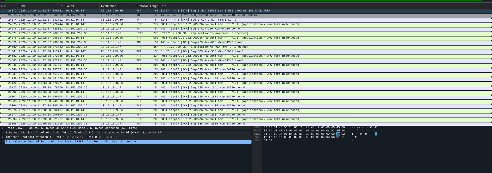
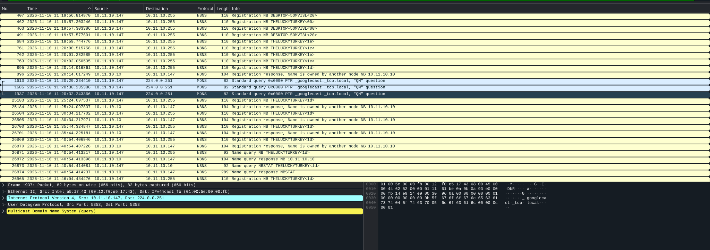
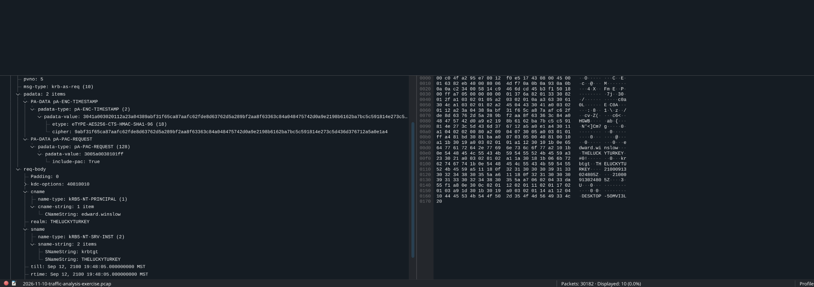

# NetSupport RAT Network Traffic Investigation

**SOC portfolio case study | Wireshark | Network forensics | November 2026**

> **Training exercise:** This investigation uses a publicly released packet capture from [Malware Traffic Analysis — The Lucky Turkey (2026-11-10)](https://www.malware-traffic-analysis.net/2026/11/10/index.html). It is not an incident handled for an employer. No malware was executed.

## Objective
Investigate an alert for suspected NetSupport RAT traffic, identify the affected endpoint and associated authenticating user, and document network evidence of possible command-and-control (C2) communications.

## Tools and methods
- Wireshark 4.6.9 on Bazzite Linux
- TCP stream and HTTP analysis, NBNS hostname correlation, Kerberos AS-REQ inspection
- Passive PCAP review; no live interaction with suspicious infrastructure

## Findings

| Item | Evidence |
| --- | --- |
| First observed suspicious TCP connection | 2026-11-10 11:22:07.509531 (Wireshark display time; timezone unverified) |
| Source IP / MAC | `10.11.10.147` / `00:12:f0:e5:17:43` |
| Hostname | `DESKTOP-5OMVI3L` (NBNS) |
| Associated Kerberos account | `THELUCKYTURKEY\edward.winslow` (AS-REQ; not proof of who operated the RAT) |
| Remote destination | `93.152.209.36:443` |
| HTTP endpoint | `/fakeurl.htm` |
| HTTP indicators | `NetSupport Manager/1.3`, `NetSupport Gateway/1.92 (Windows NT)`, `CMD=POLL`, `CMD=ENCD` |
| Behavior | Repeated HTTP POST requests approximately every 60 seconds |

## Investigation walkthrough
1. Filtered the suspected destination and confirmed the TCP three-way handshake (packets 24672–24674).
2. Inspected the HTTP requests and 200 OK responses, then followed the HTTP stream to identify NetSupport-specific headers and command fields.
3. Observed recurring POST requests, consistent with periodic automated polling.
4. Correlated NBNS registration traffic with the source IP to identify `DESKTOP-5OMVI3L`.
5. Examined Kerberos AS-REQ traffic and found `edward.winslow` in the client principal field (packet 910).

### Reproducible Wireshark filters
```text
ip.addr == 93.152.209.36 && tcp.port == 443

ip.dst == 93.152.209.36 && tcp.dstport == 443 && tcp.flags.syn == 1 && tcp.flags.ack == 0

ip.addr == 10.11.10.147 && (nbns || llmnr || mdns || dhcp)

ip.src == 10.11.10.147 && kerberos.msg_type == 10
```

## Evidence Screenshots

### 1. Suspicious HTTP Communications


### 2. Workstation Hostname Identification


### 3. Kerberos User Account Identification


## Assessment and limitations
The capture confirms NetSupport-related HTTP communications with a suspicious destination and recurring POST activity. In the context of the exercise, these observations support suspected RAT C2 traffic. **They do not independently prove** the initial infection vector, data exfiltration, or commands executed by an operator. NetSupport also has legitimate administrative uses.

**Potential MITRE ATT&CK mapping:** [T1071.001 — Application Layer Protocol: Web Protocols](https://attack.mitre.org/techniques/T1071/001/), subject to the suspected C2 interpretation.

## Recommended response in a production environment
Validate software authorization, preserve endpoint evidence, investigate process execution and persistence, review related logons and outbound traffic, and contain or block confirmed unauthorized activity according to incident-response procedures.

## Portfolio skills demonstrated
Network traffic analysis · TCP/IP · HTTP · NBNS · Kerberos · IOC identification · C2 hypothesis development · evidence-based incident documentation

## Sources
- [Malware Traffic Analysis exercise](https://www.malware-traffic-analysis.net/2026/11/10/index.html)
- [MITRE ATT&CK T1071.001](https://attack.mitre.org/techniques/T1071/001/)
